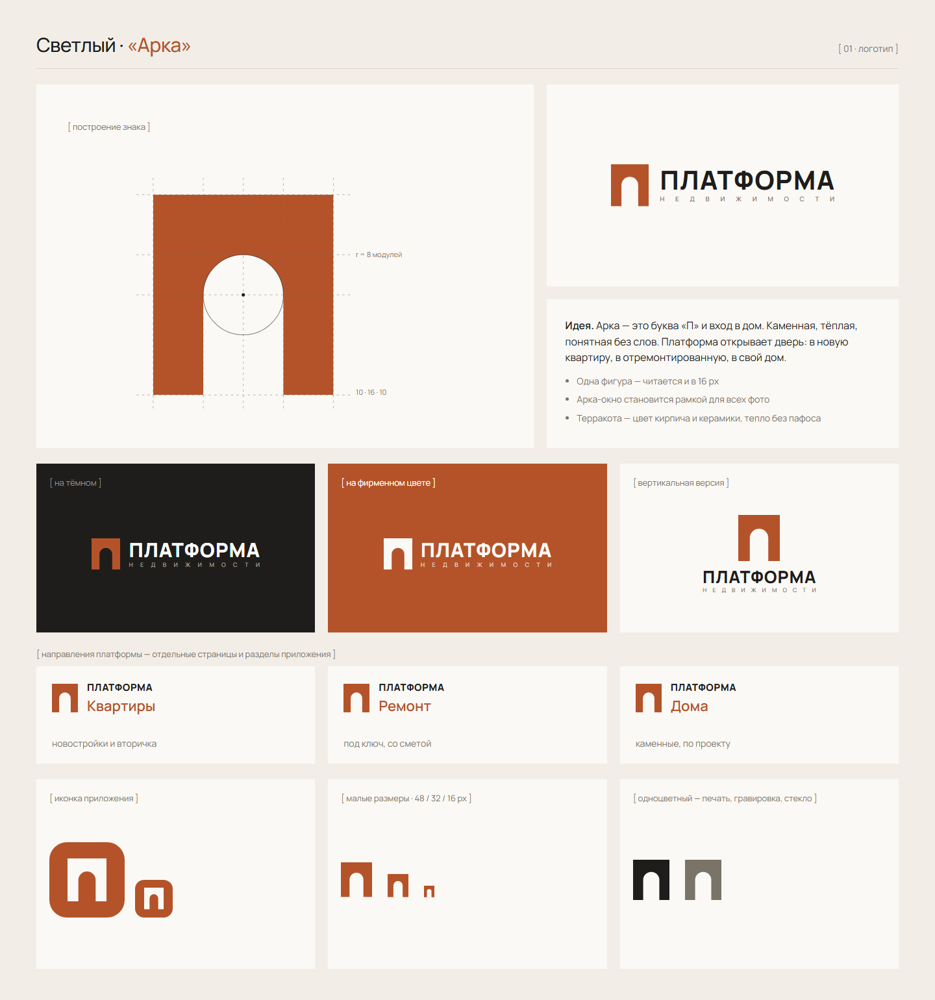
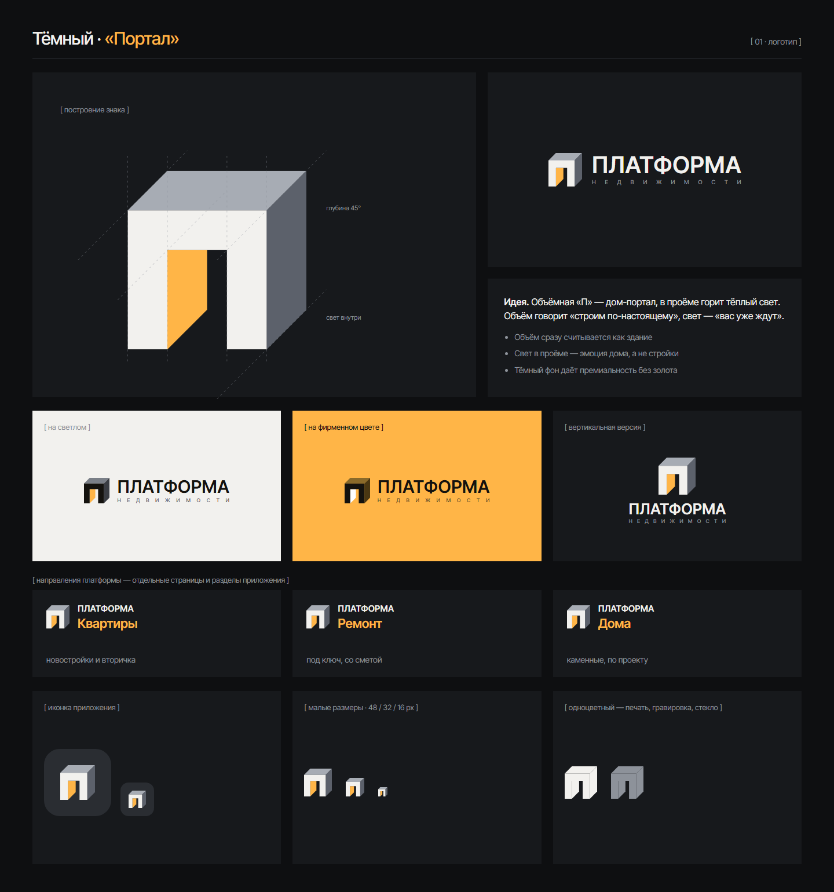
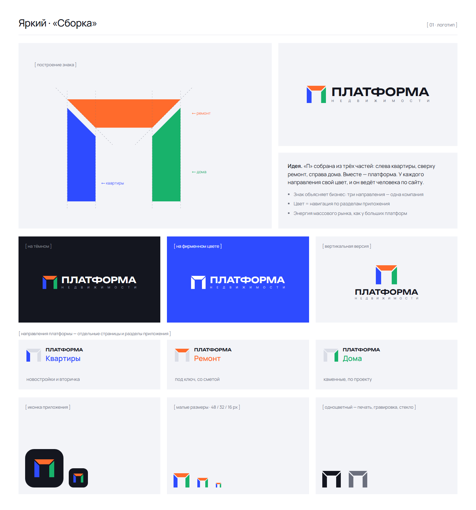

# ПЛАТФОРМА НЕДВИЖИМОСТИ — фирменный стиль и сайт-приложение

Екатеринбург · продажа квартир · ремонт квартир · строительство каменных домов.

**Галерея:** https://adervisdigital-web.github.io/platforma-nedvizhimosti/ — шесть вариантов: логотип на разных фонах и все листы.

Шесть вариантов логотипа и стиля: **1 · Светлый «Арка»**, **2 · Тёмный «Портал»**, **3 · Яркий «Сборка»**, **4 · Красный «Кладка»**, **5 · Зелёный «Свод»**, **6 · Бирюзовый «Модуль»**.

- [01_Мудборд](01_Мудборд/) — по 5 листов на вариант (PNG, PDF, HTML).
- [tools](tools/) — сборка галереи.
- [02_Логотип](02_Логотип/) — знаки в SVG.
- [00_Исследование](00_Исследование/Behance_логотипы.md) — разбор лучших работ на Behance.
- [DESIGN.md](DESIGN.md) — цвета, шрифты, идеи знаков.
- [AGENTS.md](AGENTS.md) — память проекта: бриф, правила, решения.

